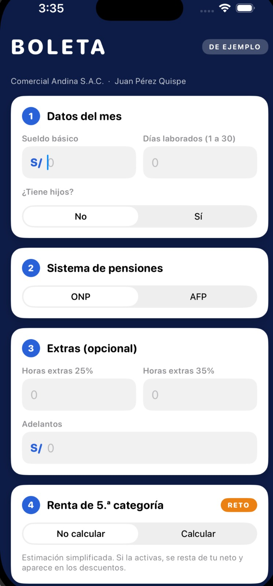
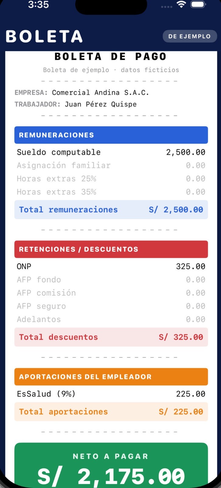
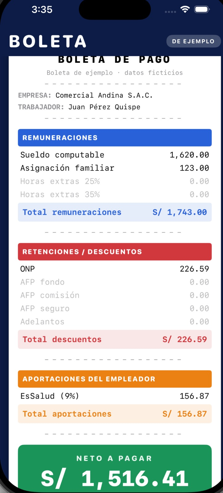
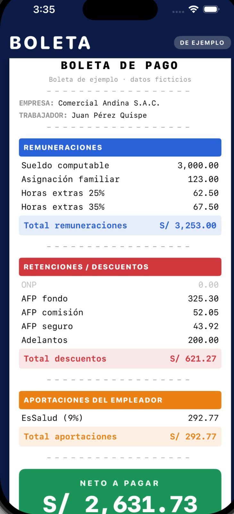
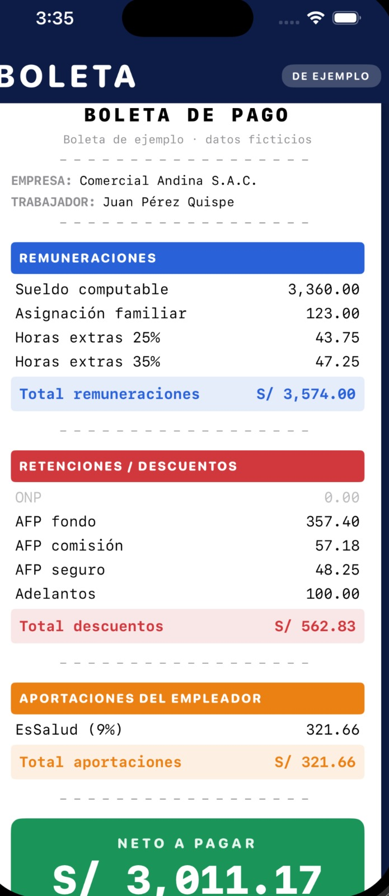
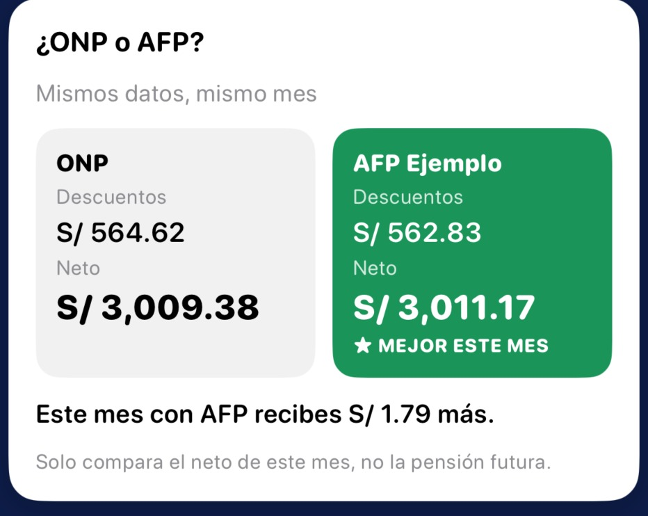

# Boleta de pago: del sueldo al neto

App móvil en **SwiftUI** (una sola pantalla) que calcula una boleta de pago simplificada a partir de los datos del mes, más una hoja de **Excel** que explica cada fórmula. Trabajo del curso **Programación en Móviles Avanzado** (Tecsup).

**Integrantes**
- Ederd Carrasco Oscco (app en SwiftUI)
- Anali Salvador Advincula (hoja de Excel)

> Todos los nombres de personas y empresas son ficticios. La pantalla indica "Boleta de ejemplo".

---

## Qué hace la app

El usuario ingresa los datos del mes y, al pulsar **Calcular**, la app muestra la boleta con sus tres bloques y el neto a pagar:

1. **Remuneraciones:** sueldo computable, asignación familiar, horas extras al 25% y al 35%.
2. **Retenciones / descuentos:** ONP o AFP (fondo, comisión y seguro), adelantos y, opcionalmente, renta de 5.ª categoría.
3. **Aportaciones del empleador:** EsSalud.

Al final muestra el **Neto a pagar**. Los conceptos que no aplican se ven con 0.00, como en la boleta real.

### Datos de entrada y validaciones

| Dato | Control | Validación |
|---|---|---|
| Sueldo básico | TextField (teclado decimal) | Mayor que cero |
| Días laborados | TextField | Entero entre 1 y 30 |
| ¿Tiene hijos? | Picker (No / Sí) | — |
| Sistema de pensiones | Picker (ONP / AFP) | — |
| AFP | Picker | Solo aparece si se elige AFP |
| Horas extras al 25% | TextField | Mayor o igual a cero |
| Horas extras al 35% | TextField | Mayor o igual a cero |
| Adelantos | TextField | Mayor o igual a cero |
| Renta de 5.ª categoría (reto) | Picker (No calcular / Calcular) | — |

Si algún dato no es válido, la app muestra un mensaje claro en rojo y no calcula.

### Niveles de avance

- **Nivel 1:** sueldo, días laborados, asignación familiar, ONP, EsSalud y neto.
- **Nivel 2:** AFP en lugar de ONP, horas extras y adelantos.
- **Nivel 3 (reto):**
  - Encabezado con razón social y nombre del trabajador ficticios.
  - ONP y AFP lado a lado en la misma pantalla.
  - Retención de renta de 5.ª categoría (versión simplificada).

---

## Estructura del código

El modelo está separado de la pantalla.

| Archivo | Contenido |
|---|---|
| `Parametros.swift` | Constantes (RMV, ONP, EsSalud, recargos, UIT), **diccionario** `tasasAFP` con las tasas de cada AFP, funciones de redondeo y formato |
| `Modelos.swift` | **Structs** de datos (`DatosBoleta`, `ResultadoBoleta`, `Concepto`, `ComparativoPension`) |
| `Boleta.swift` | **Clase `Boleta`** que calcula; arma los **arrays** de conceptos de remuneraciones y descuentos; cálculo de renta de 5.ª |
| `Validador.swift` | Validaciones con mensajes claros |
| `ContentView.swift` | Pantalla única (SwiftUI) |

La pantalla usa solo los controles vistos en clase: `Text`, `VStack`, `HStack`, `@State`, `TextField`, `Picker` y `Button`, dentro de un `ScrollView`.

## Cómo ejecutar

1. Abrir `Lab09Boleta.xcodeproj` en Xcode.
2. Elegir un simulador de iPhone.
3. Ejecutar con **Cmd + R**.

---

## Reglas de cálculo

| Concepto | Cómo se calcula |
|---|---|
| Sueldo computable | Sueldo básico ÷ 30 × días laborados |
| Asignación familiar | Si tiene hijos: 10% de la RMV (no se prorratea) |
| Valor hora | Sueldo básico ÷ 30 ÷ 8 |
| Horas extras 25% | Valor hora × 1.25 × horas |
| Horas extras 35% | Valor hora × 1.35 × horas |
| Total remuneraciones | Suma de los conceptos anteriores |
| ONP | 13% del total de remuneraciones |
| AFP | Fondo, comisión y seguro, cada uno sobre el total de remuneraciones |
| Adelantos | Se restan tal cual |
| Total descuentos | Pensión (ONP o AFP) + adelantos (+ renta de 5.ª si se activa) |
| Neto a pagar | Total remuneraciones − total descuentos |
| EsSalud (empleador) | 9% del total de remuneraciones; no se descuenta al trabajador |

Convención: cada concepto se redondea a 2 decimales y luego se suman.

### Renta de 5.ª categoría (reto, versión simplificada)

- Renta anual proyectada = remuneración mensual × 14 (12 sueldos + 2 gratificaciones).
- Base = renta anual − 7 UIT.
- Impuesto por tramos: 8% hasta 5 UIT, 14% hasta 20 UIT, 17% hasta 35 UIT, 20% hasta 45 UIT y 30% por encima.
- Retención mensual = impuesto anual ÷ 12.
- Está apagada por defecto, así que los casos 1 a 4 no la incluyen.

---

## Fuentes y parámetros

| Dato | Valor | Fuente | Fecha de consulta |
|---|---|---|---|
| RMV | S/ 1,230.00 | D.S. de la RMV, vigente desde el 1 de octubre de 2026 | 26/10/2026 |
| Asignación familiar | 10% de la RMV = S/ 123.00 | Ley 25129 | 26/10/2026 |
| ONP | 13% | D.L. 19990 | 26/10/2026 |
| EsSalud | 9% | Ley 26790 | 26/10/2026 |
| Recargo de horas extras | 25% y 35% | Normas de jornada y sobretiempo | 26/10/2026 |
| AFP Ejemplo | Fondo 10.00%, comisión 1.60%, seguro 1.35% | Valores de prueba del enunciado (en datos reales: SBS) | 26/10/2026 |
| UIT 2026 | S/ 5,500 | D.S. 301-2025-EF (MEF), publicado en El Peruano el 17/12/2025 | 26/10/2026 |
| Deducción de 7 UIT y tramos de renta de 5.ª | 7 UIT; 8%, 14%, 17%, 20%, 30% | TUO de la Ley del Impuesto a la Renta (SUNAT) | [completar fecha] |

---

## Verificación con el Excel (control cruzado)

La app y el Excel (`Boleta_Grupo_B_final.xlsx`) dan el mismo resultado, al centavo, en los 4 casos.

| Caso | Datos | Total remuneraciones | Total descuentos | Neto | EsSalud |
|---|---|---|---|---|---|
| 1 | S/ 2,500 · 30 días · sin hijos · ONP | 2,500.00 | 325.00 | **2,175.00** | 225.00 |
| 2 | S/ 1,800 · 27 días · con hijos · ONP | 1,743.00 | 226.59 | **1,516.41** | 156.87 |
| 3 | S/ 3,000 · 30 días · con hijos · AFP Ejemplo · 4 HE 25% · 4 HE 35% · adelanto S/ 200 | 3,253.00 | 621.27 | **2,631.73** | 292.77 |
| 4 | S/ 4,200 · 24 días · con hijos · AFP Ejemplo · 2 HE 25% · 2 HE 35% · adelanto S/ 100 | 3,574.00 | 562.83 | **3,011.17** | 321.66 |

Los casos 1, 2 y 3 coinciden con las respuestas del enunciado. El caso 4 no trae respuesta en el enunciado (lo revisa el docente): la app y el Excel dan el mismo resultado.

---

## Capturas

### Formulario

### Caso 1: sin hijos, ONP, mes completo

### Caso 2: con hijos y días incompletos

### Caso 3: AFP, horas extras y adelanto

### Caso 4: evaluación

### Nivel 3: comparación ONP vs AFP

### Validación con mensaje de error

---

## Análisis

Las respuestas a las 5 preguntas de análisis y la explicación de cada fórmula están en la hoja **Explicación** del Excel. Resumen:

1. **ONP o AFP (caso 3):** con AFP el neto es S/ 2,631.73 y con ONP S/ 2,630.11; AFP deja S/ 1.62 más este mes. No basta comparar porcentajes: hay que mirar también la pensión futura.
2. **Costo real para la empresa (caso 3):** S/ 3,545.77 (remuneraciones + EsSalud). Al trabajador le llega el 74.22%.
3. **Días laborados (caso 2 con 30 días):** el neto sube S/ 156.60 y el bruto S/ 180.00, porque del sueldo extra se descuenta el 13% de ONP y la asignación familiar no cambia con los días.
4. **Horas extras (caso 3):** representan el 4.00% del total de remuneraciones.
5. **Con datos reales:** [pendiente: sueldo de la oferta laboral elegida, enlace y fecha de consulta].

## Archivos del repositorio

- `Semana09/Lab09Boleta/`: proyecto de Xcode con el código de la app.
- `Semana09/capturas/`: imágenes usadas en este README.
- `Semana09/Boleta_Grupo_B_final.xlsx`: hoja de Excel (Parámetros, Boleta, Casos y Explicación).
- `Semana09/README.md`: este archivo.
